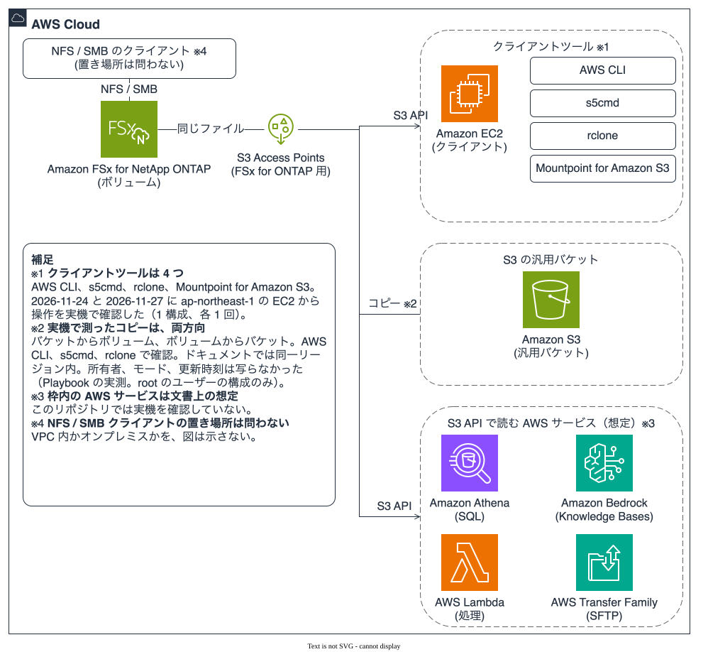

# FSx for ONTAP S3 Access Points クライアントアクセスパターン

🌐 **言語**: **日本語** | [English](README.en.md)

Amazon FSx for NetApp ONTAP（以下 FSx for ONTAP）の S3 Access Points を、利用者の端末やサーバのクライアントツールから使うときの手順、確認結果、選び方を集めたリポジトリです。

> **現在の状態**: 1 構成・各操作 1 回の実機確認です。4 つのツール（AWS CLI、s5cmd、rclone、Mountpoint for Amazon S3）を 2026-11-24 に確かめました（[記録](benchmarks/records/2026-11-24-client-tools-stage3.md)）。性能の数値はありません。商用ツールと rclone mount は未確認（`candidate`）のままです。

図 1: クライアントツール、S3 Access Points、ボリューム、バケット、後続の AWS サービスの関係。右下のサービスは文書上の想定で、実機は未確認です。

## 読み始める場所

| 知りたいこと | 読む文書 |
|---|---|
| どんな場面で使われるか（オンプレミスの ONTAP、新規と既存の FSx for ONTAP の利用者） | [docs/use-cases.md](docs/use-cases.md) |
| どの AWS サービスや製品とつながり、どのクライアントツールが関わるか | [docs/integrations-map.md](docs/integrations-map.md) |
| ツールごとの確認状況 | [docs/compatibility-matrix.md](docs/compatibility-matrix.md) |
| 用途と要件からの選び方 | [docs/how-to-choose.md](docs/how-to-choose.md) |
| バケットとボリュームの間のサーバー側コピー | [docs/server-side-copy.md](docs/server-side-copy.md) |

AI エージェント向けの索引は [llms.txt](llms.txt) と [AGENTS.md](AGENTS.md) にあります。

## このリポジトリの位置づけ

S3 Access Points の仕様、上限、選定に影響する FSx for ONTAP のコア仕様は、全体の入口である [FSx-for-ONTAP-Adoption-Playbook](https://github.com/Yoshiki0705/FSx-for-ONTAP-Adoption-Playbook)（以下 Playbook）が持ちます。このリポジトリは Playbook 配下の Spoke の 1 つで、仕様を複製せず、リンクで参照します。Spoke が持つのは、クライアントツール側の手順、チェックリスト、測定記録です。後続のサーバーレス処理の実装は、兄弟の Spoke である [FSx-for-ONTAP-S3AccessPoints-Serverless-Patterns](https://github.com/Yoshiki0705/FSx-for-ONTAP-S3AccessPoints-Serverless-Patterns) が持ちます。

| 置き場所 | 持つもの |
|---|---|
| Playbook | S3 Access Points の仕様と上限、FSx for ONTAP のコア仕様のうち他サービスとの選定に影響するもの、横断の規約 |
| Spoke（このリポジトリ） | クライアントツールの設定手順、手動チェックリスト、ベンチマーク記録、互換性マトリクス |
| 兄弟 Spoke（Serverless-Patterns） | 後続のサーバーレス処理の実装、ファイルシステムの運用パターン |

3 つのリポジトリの関係は [docs/spoke-relations.md](docs/spoke-relations.md) に図で示しています。

## 参照の固定

Playbook へのリンクはコミット SHA に、Serverless-Patterns へのリンクはリリースタグに固定しています。値は [docs/reference-pins.md](docs/reference-pins.md) だけに書き、`make drift` が全リンクと照合します。仕様や上限を知りたいときは、まず Playbook の [S3 Access Points の制約ノート](https://github.com/Yoshiki0705/FSx-for-ONTAP-Adoption-Playbook/blob/a4c8367f9172ee88f0af25731752af63dc2c6225/docs/ja/domains/data-utilization/notes/s3-access-point-constraints.md) を読んでください。

## 対象ツール

| 群 | ツール | ディレクトリ |
|---|---|---|
| 取り込み・転送 | AWS CLI、rclone、s5cmd、AWS Transfer Family、File Mover Express | [patterns/ingest](patterns/ingest) |
| ストリーミング・マウント | Mountpoint for Amazon S3、rclone mount、LucidLink Connect、LucidLink Suite | [patterns/streaming](patterns/streaming) |
| MCP クライアント | Kiro、Claude Desktop | [patterns/mcp](patterns/mcp) |

商用ツール（File Mover Express、LucidLink の 2 製品）は、手元で確認できる範囲の手動チェックリストを [checklists/vendor](checklists/vendor) に置きます。エージェントは商用ツールを操作しません。

## 確認水準

| 記号 | 水準 | 意味 |
|---|---|---|
| `C` | `candidate` | 未確認。数値を書かない |
| `D` | `documented` | 公式ドキュメントに書かれている。URL と確認日を付ける |
| `M` | `measured` | 自分で実行して確認した。記録へのリンクを付ける |

詳細は [docs/compatibility-matrix.md](docs/compatibility-matrix.md) にあります。

## 選び方への導線

用途と要件から選ぶ表は [docs/how-to-choose.md](docs/how-to-choose.md) にあります。どの選択肢にも制約があり、表は制約を同じ形式で並べます。

## 使い始める手順

1. `make install` で開発依存を入れる（ruff を固定した版で入れます）。
2. `make all` で、lint、ゲート、テスト、シークレットスキャンを実行する。
3. 新しいパターンは [docs/templates](docs/templates) の雛形から作る。
4. 実機ベンチマークは、費用の見込みと後片付けの手順を示して承認を得てから、手動で実行する（[benchmarks/README.md](benchmarks/README.md)）。

## 言語の追加

README は日本語と英語の 2 言語です。追加の手順は [docs/adding-a-language.md](docs/adding-a-language.md) にあります。

## ライセンス

MIT。[LICENSE](LICENSE) を参照してください。
