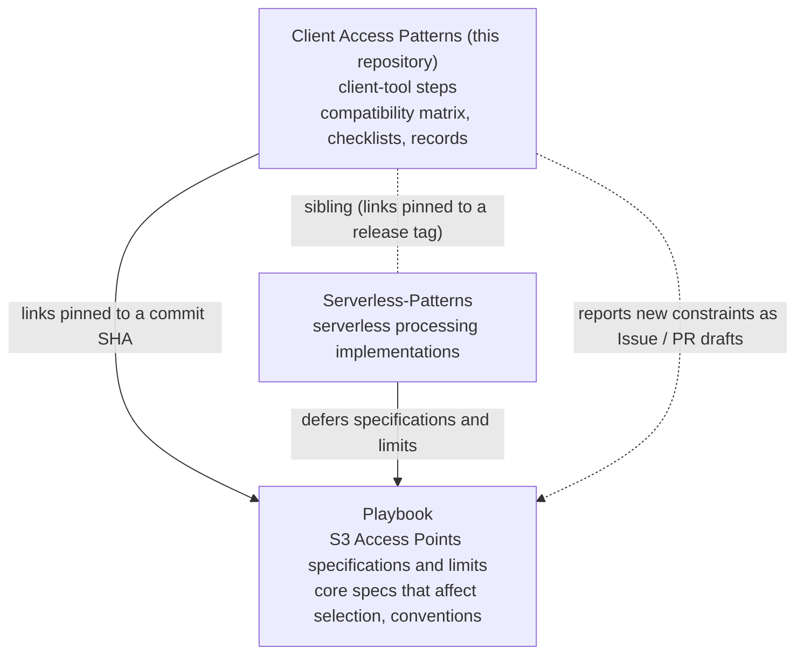

# The Playbook and its two Spokes

This repository (Client Access Patterns) is one Spoke under the Playbook. The other Spoke, Serverless-Patterns, is its sibling, and neither is the source of truth for the other.

🌐 **Language**: [日本語](spoke-relations.md) | **English**

## Division of labour

| Where | What it holds |
|---|---|
| [FSx-for-ONTAP-Adoption-Playbook](https://github.com/Yoshiki0705/FSx-for-ONTAP-Adoption-Playbook) (the Playbook) | The entry point. The core FSx for ONTAP specifications that affect choosing it against other services, S3 Access Points specifications and limits, cross-repository conventions |
| Client Access Patterns (this repository) | Client-tool setup steps, manual checklists, benchmark records, the compatibility matrix |
| [FSx-for-ONTAP-S3AccessPoints-Serverless-Patterns](https://github.com/Yoshiki0705/FSx-for-ONTAP-S3AccessPoints-Serverless-Patterns) (Serverless-Patterns) | Serverless processing implementations that follow, operational patterns for the file system |

The Playbook holds specifications and limits, and no Spoke copies them. A Spoke holds the details in its own GitHub repository and its paired Kiro Project.

## Relationship diagram

The table above and the next section state the same content in prose.

## Flow of information

1. This repository links to Playbook documents with commit-SHA-pinned links, and to Serverless-Patterns documents with release-tag-pinned links. Both values are written in one place, [docs/reference-pins.md](reference-pins.md).
2. When using a client tool here turns up an S3 Access Points constraint, or a specification that affects selection, that the Playbook does not record, the observed fact, steps to reproduce, environment and a successful control are written up as a draft Issue or PR for the Playbook ([procedure](agent/playbook-feedback-flow.md)).
3. The user decides whether to submit a draft. After the Playbook reflects it, this repository moves its pinned commit forward.
4. Findings about the serverless processing implementation go into a draft addressed to Serverless-Patterns.
