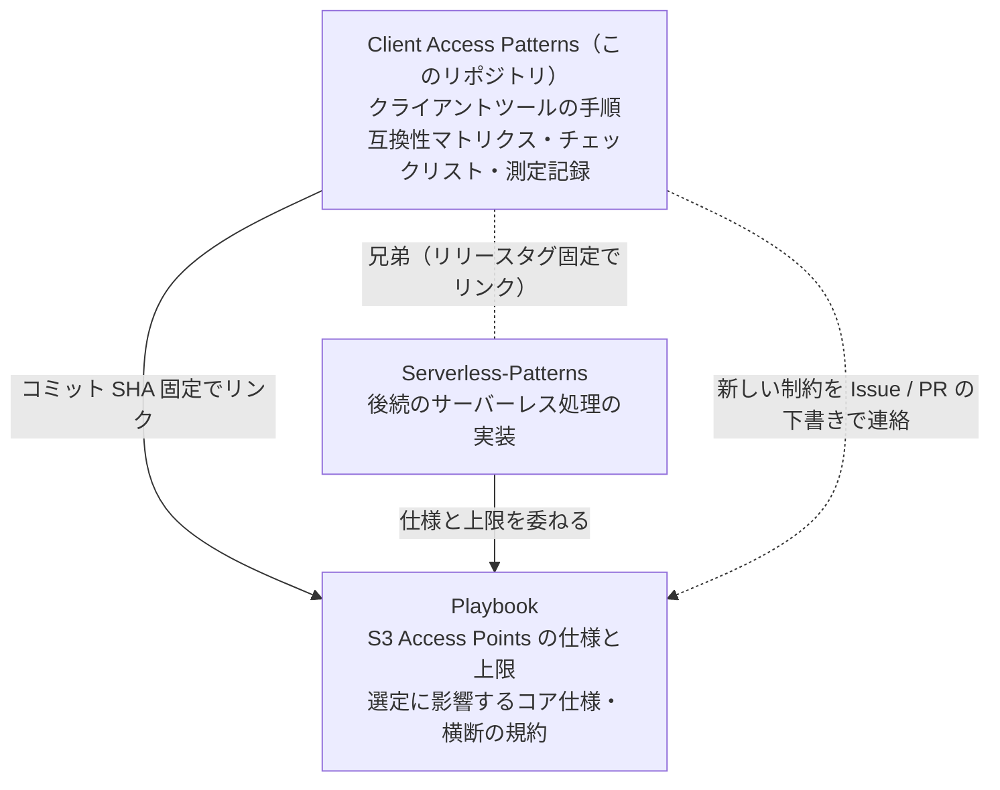

# Playbook と 2 つの Spoke の関係

このリポジトリ（以下 Client Access Patterns）は、Playbook 配下の Spoke の 1 つです。もう 1 つの Spoke である Serverless-Patterns とは兄弟の関係で、互いに参照元と参照先の関係はありません。

🌐 **言語**: **日本語** | [English](spoke-relations.en.md)

## 分担

| 場所 | 持っているもの |
|---|---|
| [FSx-for-ONTAP-Adoption-Playbook](https://github.com/Yoshiki0705/FSx-for-ONTAP-Adoption-Playbook)（Playbook） | 全体の入口。FSx for ONTAP のコア仕様のうち他サービスとの選定に影響するもの、S3 Access Points の仕様と上限、横断の規約 |
| Client Access Patterns（このリポジトリ） | クライアントツールの設定手順、手動チェックリスト、ベンチマーク記録、互換性マトリクス |
| [FSx-for-ONTAP-S3AccessPoints-Serverless-Patterns](https://github.com/Yoshiki0705/FSx-for-ONTAP-S3AccessPoints-Serverless-Patterns)（Serverless-Patterns） | 後続のサーバーレス処理の実装、ファイルシステムの運用パターン |

仕様と上限は Playbook が持ち、各 Spoke は複製しません。Spoke が持つのは、その Spoke の GitHub リポジトリと、対になる Kiro Project にある詳細です。

## 関係図

図の内容は上の表と次の節で文章にしています。

## 情報の流れ

1. このリポジトリは、Playbook の文書をコミット SHA 固定のリンクで参照します。Serverless-Patterns の文書はリリースタグ固定のリンクで参照します。2 つの値は [docs/reference-pins.md](reference-pins.md) の 1 か所にだけ書かれます。
2. このリポジトリでクライアントツールを使い、Playbook の記述にない S3 Access Points の制約や選定に影響する仕様を見つけたとき、観測した事実、再現手順、環境、成功した対照を Playbook への Issue または PR の下書きにまとめます（[手順](agent/playbook-feedback-flow.md)）。
3. 下書きを提出するかどうかは利用者が決めます。Playbook が反映した後、このリポジトリは固定したコミットを新しいものへ更新します。
4. サーバーレス処理の実装に関する所見は、Serverless-Patterns 向けの下書きにします。
