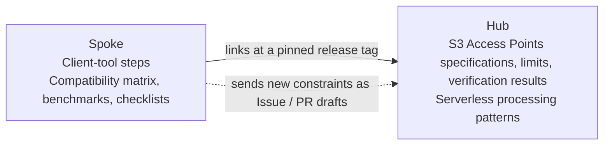

# New Hub document (English): `docs/client-access-patterns-relation.en.md`

> Draft. Not applied to Hub. Save everything after the `---` below as `docs/client-access-patterns-relation.en.md` in Hub. The Japanese version is [docs-hub-spoke-relation.md](docs-hub-spoke-relation.md) (`docs/client-access-patterns-relation.md` in Hub).

---

# Relationship to the Client Access Patterns Repository

🌐 **Language / 言語**: [日本語](client-access-patterns-relation.md) | English

This page shows how this repository (the Hub) and [FSx-for-ONTAP-S3AccessPoints-Client-Access-Patterns](https://github.com/Yoshiki0705/FSx-for-ONTAP-S3AccessPoints-Client-Access-Patterns) (the Spoke) divide the work.

## Division of work

| Where | What it holds |
|---|---|
| Hub (this repository) | Amazon FSx for NetApp ONTAP (FSx for ONTAP) S3 Access Points specifications, limits, supported APIs, verification results, and serverless processing patterns. The single source for statements about S3 Access Points |
| Spoke | Client-tool setup steps, manual checklists, benchmark records, and a compatibility matrix |

The Spoke does not copy S3 Access Points specifications or limits. Its links into the Hub all go through one release tag that the Spoke pins.

## Relationship diagram

## Flow of information

1. The Spoke refers to Hub documents through links at a pinned release tag. The tag is written in one place in the Spoke (`docs/hub-pin.md`).
2. When the Spoke finds an S3 Access Points constraint that the Hub does not describe, it collects the observed facts, steps to reproduce, environment, and a control that succeeded into an Issue or PR draft for the Hub.
3. The Spoke's user decides whether to submit the draft to the Hub. After the Hub reflects it, the Spoke updates its pin to the new tag.

## Related documents

- [S3 Access Points compatibility notes](s3ap-compatibility-notes.en.md)
- [Documentation index](index.md)
