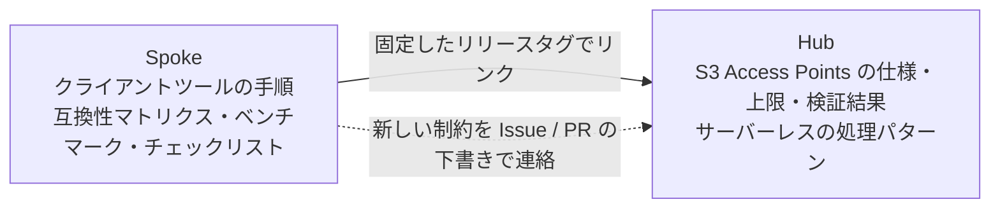

# Hub 向け新規文書（日本語）: `docs/client-access-patterns-relation.md`

> 下書きです。Hub には適用していません。下の `---` 以降の全体を、Hub の `docs/client-access-patterns-relation.md` として保存します。英語版は [docs-hub-spoke-relation.en.md](docs-hub-spoke-relation.en.md)（Hub では `docs/client-access-patterns-relation.en.md`）。

---

# クライアントアクセスパターン用リポジトリとの関係

🌐 **Language / 言語**: 日本語 | [English](client-access-patterns-relation.en.md)

このリポジトリ（Hub）と [FSx-for-ONTAP-S3AccessPoints-Client-Access-Patterns](https://github.com/Yoshiki0705/FSx-for-ONTAP-S3AccessPoints-Client-Access-Patterns)（以下 Spoke）の分担を示します。

## 分担

| 場所 | 持っているもの |
|---|---|
| Hub（このリポジトリ） | Amazon FSx for NetApp ONTAP（以下 FSx for ONTAP）の S3 Access Points の仕様、上限、対応 API、検証結果、サーバーレスの処理パターン。S3 Access Points に関する記述の唯一の出典 |
| Spoke | クライアントツールの設定手順、手動チェックリスト、ベンチマーク記録、互換性マトリクス |

Spoke は S3 Access Points の仕様や上限を複製しません。Hub への参照は、Spoke 側で固定した 1 つのリリースタグ経由のリンクに限ります。

## 関係図

## 情報の流れ

1. Spoke は、Hub の文書を固定したリリースタグのリンクで参照します。タグは Spoke の 1 か所（`docs/hub-pin.md`）にだけ書かれます。
2. Spoke でクライアントツールを使って、Hub の記述にない S3 Access Points の制約を見つけたとき、Spoke は観測した事実、再現手順、環境、成功した対照を Hub への Issue または PR の下書きにまとめます。
3. 下書きを Hub に提出するかどうかは、Spoke の利用者が決めます。Hub が反映した後、Spoke は固定タグを新しいタグへ更新します。

## 関連文書

- [S3 Access Points の互換性メモ](s3ap-compatibility-notes.md)
- [ドキュメント索引](index.md)
